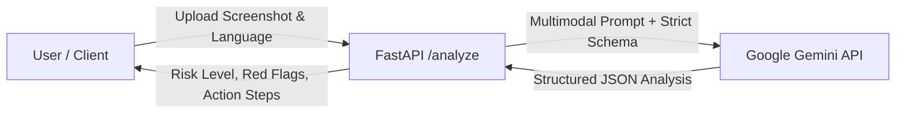

# 🔍 PlainSight

[](LICENSE)
[](https://www.python.org/)
[](https://fastapi.tiangolo.com/)
[](https://ai.google.dev/)

> **PlainSight** is an AI-powered document and screenshot risk analyzer tailored for digital users in India. Powered by Google Gemini's multimodal reasoning, it deciphers confusing screenshots (UPI collect requests, suspicious SMS, utility bills, lottery scams) into simple, jargon-free explanations with clear scam warnings and actionable advice across multiple regional languages.

---

## 🌟 Key Features

- **Multimodal Visual Analysis**: Inspects payment requests, SMS messages, banking notices, and digital bills directly from uploaded images.
- **Scam & Fraud Red Flag Detection**: Identifies psychological triggers (urgency, panic, too-good-to-be-true rewards) and fraudulent patterns (unsolicited UPI requests, lookalike sender IDs, phishing links).
- **Strict Safety Guardrails**: Designed with privacy and fraud prevention in mind—never stores or echoes back sensitive credentials like OTPs, UPI PINs, or account numbers.
- **Multilingual Explanations**: Delivers clear guidance in regional languages:
  - 🇬🇧 English (`en`)
  - 🇮🇳 Hindi (`hi`)
  - 🇮🇳 Marathi (`mr`)
- **Deterministic Structured Output**: Employs Gemini's native `response_schema` to guarantee valid, machine-readable JSON responses.
- **Antigravity Agent Skill**: Includes a native agent skill definition (`skill/plainsight-explainer/SKILL.md`) for integration into AI agent ecosystems.

---

## 🏗️ Architecture & Workflow



---

## 📁 Repository Structure

```text
plain-sight/
├── app/
│   ├── main.py                  # FastAPI application and /analyze route
│   ├── prompts.py               # System prompt & structured JSON response schema
│   └── static/
│       └── index.html           # Web interface entry point
├── eval/
│   ├── run_eval.py              # Evaluation harness for testing accuracy
│   └── expected.json            # Ground-truth test dataset
├── skill/
│   └── plainsight-explainer/
│       └── SKILL.md             # Antigravity agent skill definition
├── .env                         # Environment configuration (API keys, model ID)
├── .gitignore                   # Git ignore patterns
├── LICENSE                      # MIT License
├── README.md                    # Project documentation
└── requirements.txt             # Python dependencies
```

---

## 🚀 Getting Started

### Prerequisites

- **Python 3.10+**
- A **Google Gemini API Key** (Get one from [Google AI Studio](https://aistudio.google.com/))

### 1. Clone the Repository

```bash
git clone https://github.com/kamlesh0928/plain-sight.git
cd plain-sight
```

### 2. Create and Activate a Virtual Environment

```bash
# Windows (PowerShell)
python -m venv .venv
.venv\Scripts\Activate.ps1

# Linux / macOS
python3 -m venv .venv
source .venv/bin/activate
```

### 3. Install Dependencies

```bash
pip install -r requirements.txt
```

### 4. Configure Environment Variables

Create or update your `.env` file in the root directory:

```env
GEMINI_API_KEY="your_actual_gemini_api_key_here"
MODEL_ID="gemini-2.5-flash"
```

---

## 💻 Running the Application

Start the FastAPI development server with Uvicorn:

```bash
uvicorn app.main:app --reload --port 8000
```

Once running:
- **Web App**: Open [http://localhost:8000](http://localhost:8000)
- **Interactive API Docs (Swagger UI)**: Open [http://localhost:8000/docs](http://localhost:8000/docs)
- **Alternative Docs (ReDoc)**: Open [http://localhost:8000/redoc](http://localhost:8000/redoc)

---

## 📡 API Reference

### `POST /analyze`

Analyzes an uploaded screenshot or document image and outputs a risk evaluation and explanation.

#### Request

- **Content-Type**: `multipart/form-data`
- **Parameters**:
  - `image` *(File, required)*: The image file to analyze (`.png`, `.jpg`, `.jpeg`, `.webp`).
  - `lang` *(Form string, optional)*: Language code for the output explanation (`en`, `hi`, `mr`). Defaults to `en`.

#### Example cURL Request

```bash
curl -X POST "http://localhost:8000/analyze" \
  -F "image=@/path/to/screenshot.png" \
  -F "lang=hi"
```

#### Example Response Body

```json
{
  "doc_type": "UPI Collect Request",
  "summary": "यह एक अज्ञात व्यक्ति द्वारा पैसे मांगने का अनुरोध (Collect Request) है, लॉटरी या इनाम नहीं।",
  "risk_level": "likely_scam",
  "red_flags": [
    "पैसे पाने के लिए UPI PIN दर्ज करने को कहा जा रहा है",
    "प्रेषक का नाम अज्ञात और संदिग्ध है",
    "तुरंत भुगतान करने का दबाव बनाया गया है"
  ],
  "what_to_do": [
    "अनुरोध को तुरंत अस्वीकार (Decline) करें",
    "अपना UPI PIN कभी दर्ज न करें — पैसे प्राप्त करने के लिए PIN की आवश्यकता नहीं होती",
    "इस प्रेषक को अपने UPI ऐप में रिपोर्ट और ब्लॉक करें"
  ],
  "confidence": "high"
}
```

#### Response Fields

| Field | Type | Description |
| :--- | :--- | :--- |
| `doc_type` | `string` | Classification of the document (e.g. *UPI Collect Request*, *Bank SMS*, *Electricity Bill*). |
| `summary` | `string` | Simple, short explanation tailored to non-technical users. |
| `risk_level` | `string` | Security risk assessment: `"safe"`, `"careful"`, or `"likely_scam"`. |
| `red_flags` | `array[string]` | Specific warning indicators found in the image. |
| `what_to_do` | `array[string]` | 2–4 actionable steps the user should follow. |
| `confidence` | `string` | Evaluation confidence level: `"low"`, `"medium"`, or `"high"`. |

---

## 🛡️ Risk Classification Guidelines

| Level | Criteria | Example Scenarios |
| :--- | :--- | :--- |
| 🟢 **safe** | Legitimate receipts, official utility bills, verified standard transactions with no anomalies. | Electricity bill, successful transfer receipt from known contact. |
| 🟡 **careful** | Ambiguous senders, unconfirmed payments, or requests requiring secondary verification. | New merchant payment link, delivery rescheduling notice. |
| 🔴 **likely_scam** | Demands for PIN/OTP to receive funds, urgent threats of account closure, phishing URLs, lottery/job scams. | Fake lottery SMS, unauthorized UPI collect request asking for PIN. |

---

## 🤖 Agent Skill Integration

PlainSight comes equipped with an agent skill definition located in:
[`skill/plainsight-explainer/SKILL.md`](skill/plainsight-explainer/SKILL.md)

This allows Antigravity and compatible agent frameworks to automatically invoke PlainSight whenever a user submits an image or document they find suspicious or confusing.

---

## 🧪 Testing & Evaluation

The repository includes an evaluation directory (`eval/`) designed to benchmark model classification accuracy against known safe and fraudulent samples:

```bash
python eval/run_eval.py
```

---

## 📜 License

This project is licensed under the MIT License — see the [LICENSE](LICENSE) file for details.